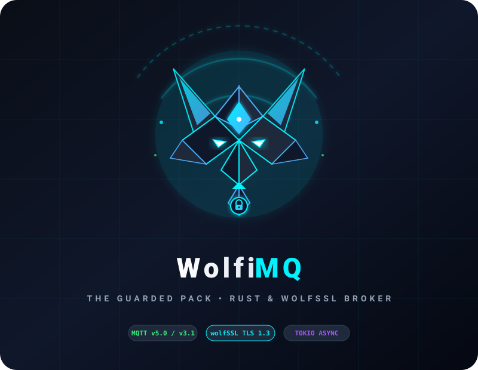

<p align="center">
  
</p>

<p align="center">
  <strong>Ultra-Secure, High-Performance MQTT v3.1.1 & v5.0 Broker written in Rust with wolfSSL Integration</strong>
</p>

<p align="center">
  <a href="#features">Features</a> •
  <a href="#architecture">Architecture</a> •
  <a href="#quick-start">Quick Start</a> •
  <a href="#configuration">Configuration</a> •
  <a href="#testing--ci">Testing & CI</a>
</p>

---

## Features

- **Dual Protocol Support:** Native cross-version routing between **MQTT v3.1.1** and **MQTT v5.0** clients.
- **wolfSSL Cryptographic Engine:**
  - TLS 1.3 / 1.2 with strict Mutual TLS (mTLS) client certificate verification.
  - Pre-Shared Key (PSK) support for ultra-constrained IoT nodes without certificate parsing.
  - ALPN (Application-Layer Protocol Negotiation) with protocol ID `"mqtt"`.
  - Session Resumption / Session Tickets for ultra-fast reconnects without handshake overhead.
- **Memory Safety & Flow Control:**
  - Zero-cost memory safety with pure Rust concurrency.
  - Configurable backpressure policies (`drop_oldest`, `drop_newest`, `reject_publisher`) preventing Out-Of-Memory (OOM) crashes from slow consumers.
- **Structured Observability:**
  - Dynamic log levels (`trace`, `debug`, `info`, `warn`, `error`).
  - Pluggable log formats (`pretty`, `compact`, `json`).
- **Test-Driven Rigor:** 7-layer testing suite integrated with `Taskfile` and automated GitHub Actions CI.

---

## Quick Start

### 1. Prerequisites
Managed automatically via [`mise`](https://mise.jdx.dev):
- Rust 1.99+ (installed via `mise`)
- Go-Task (`task`)

### 2. Available Task Commands
```bash
# View all available tasks
task

# Run full CI check locally (Formatting, Clippy Lints, Type check, All tests)
task ci

# Generate local test certificates for mTLS
task certs:gen

# Run unit tests
task test:unit

# Run integration tests
task test:integration

# Build release binary
task build:release
```

---

## Configuration

Edit [`config/broker.toml`](config/broker.toml) to customize your broker:

```toml
[logging]
level = "info"          # "trace", "debug", "info", "warn", "error"
format = "pretty"       # "pretty", "compact", "json"

[listeners.tls]
enabled = true
port = 8883

[security.tls]
ca_cert_file = "certs/ca-cert.pem"
server_cert_file = "certs/server-cert.pem"
server_key_file = "certs/server-key.pem"
require_client_cert = true
min_tls_version = "TLSv1.3"
alpn_protocols = ["mqtt"]

[mqtt.queues]
max_queued_messages = 5000
queue_full_policy = "drop_oldest"
```

---

## License
Licensed under Apache-2.0 or MIT.
